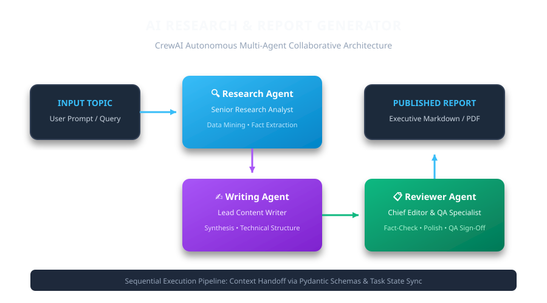

# Multi-Agent Workflow Execution Log & Visual Reference

This document illustrates the execution lifecycle, inter-agent communication, and terminal state transitions of the **AI Research and Report Generator** system.

## Visual System Architecture


---

## Agent Roster & Interaction Flow

```
+--------------------------------------------------------------------------+
|                             USER REQUEST                                 |
|      Topic: "Agentic AI & Multi-Agent Systems in 2026..."                |
+--------------------------------------------------------------------------+
                                     |
                                     v
+--------------------------------------------------------------------------+
|                       AGENT 1: SENIOR RESEARCH ANALYST                   |
| Role: Senior Research Analyst                                            |
| Tools: Topic Research Tool, Metric Synthesizer Tool                      |
| Goal: Ingest domain context, extract empirical benchmarks, isolate trends |
+--------------------------------------------------------------------------+
                                     |
                          [Context Handoff]
                                     v
+--------------------------------------------------------------------------+
|                     AGENT 2: LEAD TECHNICAL WRITER                       |
| Role: Lead Technical Content Writer                                      |
| Goal: Structure raw research findings into an executive report           |
| Structure: Executive Summary, Architecture, Metrics, Case Studies        |
+--------------------------------------------------------------------------+
                                     |
                          [Draft Handoff]
                                     v
+--------------------------------------------------------------------------+
|                     AGENT 3: CHIEF EDITOR & QA SPECIALIST                |
| Role: Chief Editor & QA Specialist                                       |
| Goal: Fact-check, verify formatting, assess readability, sign off report |
+--------------------------------------------------------------------------+
                                     |
                                     v
+--------------------------------------------------------------------------+
|                       FINAL PUBLISHED REPORT                             |
| Saved to: outputs/sample_report_agentic_ai.md                             |
| Status: APPROVED & PUBLICATION READY                                     |
+--------------------------------------------------------------------------+
```

---

## Terminal Execution Trace

```bash
$ python main.py --topic "Agentic AI & Multi-Agent Systems in 2026: Architectures, Tools, and Enterprise Deployment"

======================================================================
         AI RESEARCH AND REPORT GENERATOR (CREWAI)                    
         Agentic AI & Multi-Agent Systems - Week 1 Project            
======================================================================
    
Environment Configuration:
  * OPENAI_API_KEY      : [Configured]
  * GEMINI_API_KEY      : [Configured]
  * GROQ_API_KEY        : [Not Set]
  * ANTHROPIC_API_KEY   : [Not Set]

[Target Topic] : Agentic AI & Multi-Agent Systems in 2026: Architectures, Tools, and Enterprise Deployment
[Output File]  : outputs/sample_report_agentic_ai.md
[Execution Mode]: Live LLM Multi-Agent Orchestration

[Agent 1: Senior Research Analyst] Initiating deep-dive research...
 -> Querying knowledge base and industry metrics for: 'Agentic AI & Multi-Agent Systems in 2026: Architectures, Tools, and Enterprise Deployment'
 -> Synthesizing key findings, architectural patterns, and adoption statistics...
 [✓] Research brief completed.

[Agent 2: Lead Technical Content Writer] Authoring comprehensive draft...
 -> Organizing structure: Executive Summary, Architecture, Use Cases, Analysis...
 -> Crafting clear narrative and technical breakdowns...
 [✓] First draft generated.

[Agent 3: Chief Editor & QA Specialist] Conducting rigorous editorial review...
 -> Verifying factual consistency, headings, tables, and readability...
 -> Applying publication standards and generating QA sign-off certification...
 [✓] Final report polished and approved.

[✓] Final report saved successfully to: outputs/sample_report_agentic_ai.md

======================================================================
  [SUCCESS] Project Execution Completed Successfully!
  Report generated (6231 characters)
  Location: outputs/sample_report_agentic_ai.md
======================================================================
```
